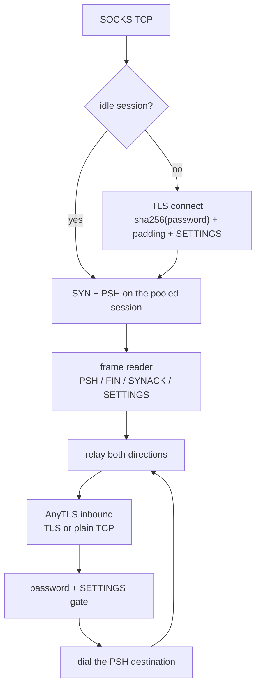

# AnyTLS

AnyTLS v2 is a password-authenticated stream multiplexer carried over TLS, or plain TCP on an inbound. Both roles are served: a `protocol: anytls` inbound reads `settings.users`/`clients` or `settings.password`, and an outbound reads the first `settings.servers` entry or the flat settings. The prologue is `sha256(password)` followed by a two-byte padding length and that many zero bytes.

Frames carry a one-byte command, a four-byte big-endian stream id and a two-byte length. A stream opens with `SYN`, carries its SOCKS destination in the first `PSH`, and ends with `FIN`; `SETTINGS` must arrive before the first `SYN`. A v2 peer gets an empty `SYNACK` for a successful dial or a `SYNACK` error for a failed one, followed by `FIN`. `UPDATE_PADDING_SCHEME` replaces the client's padding factory, and a client advertising `v >= 2` gets `SERVER_SETTINGS` back. The default padding scheme is the reference's `stop=8` table: the handshake uses record 0's 30 bytes, and later records both split long writes and add `WASTE` frames to the generated payload size. Padding is random, so only its structure is claimed, never its bytes.

One authenticated session carries every stream. The outbound keeps up to eight idle sessions and reuses a live one; the server keeps one `Shared` per connection and spawns a worker per `SYN`. UDP-over-stream (UoT) is not carried, so `udp_lane_supported` returns false for this protocol; anytls itself carries TCP flows only. An outbound requires `streamSettings.security: "tls"` as sing-box does, while an inbound serves plaintext when security is empty or `none`.

## Data path

## Measured

<!-- counts:begin -->
| key | value | checked by |
| --- | --- | --- |
| ops-retired-instructions | UNBLESSED | scripts/count-ops.sh |
| syscalls-per-connect | UNBLESSED | scripts/count-ops.sh |
| payload-copies-per-frame | UNBLESSED | scripts/count-ops.sh |
| nanoseconds-per-frame | UNBLESSED | .github/workflows/bench.yml |
| address-families | 3 | ferrox-app-anytls::tests::addresses_round_trip |
| padding-scheme-md5 | 75cff2ad89aadf5e257059ee571ebe11 | ferrox-app-anytls::tests::the_default_padding_md5_is_the_reference_one |
| outbound-spellings-parsed | 2 | ferrox-app-anytls::tests::outbound_spellings_parse |
<!-- counts:end -->

## What was removed

Against sing-box's `protocol/anytls/`, sing-anytls and xray-core-rust's `xray-proxy-anytls`, this is a rewrite: one frame codec and one `Shared` table serve both roles, and the server and client share the same `AnyTlsStream`. Xray-core as pinned has no AnyTLS wire implementation, and ZeroNet's `zero-protocol::anytls` is a single-stream subset with no session pool; against those two there is no pooled route to remove. The reference client keeps a pending-settings buffer that is prepended to the first frame write; this implementation does the same through `Shared::queue_pending`, so the first stream's `SYN` and `PSH` leave in one padded packet. The server keeps one `Shared` per connection instead of allocating a session per accepted `SYN`. The frame reader already owns each frame's payload `Vec`, so a read hands that `Vec` to the stream's queue: the downlink pays one allocation per frame and no copy into the queue while the stream holds fewer than `QUEUE_CHUNKS` buffers — past that limit a payload is appended to the tail buffer. A stream read memcpys out of whole queued frames instead of one byte at a time.

What is not removed: the auth prologue still hashes the password with SHA-256, every frame still has a seven-byte header, the client still copies each write into a packet before padding, padding still generates `WASTE` frames, and the server keeps one `Shared` per connection while every stream shares it. The four count rows above stay `UNBLESSED`: no `ops.yml` run has measured this page, and `bench.yml` has no AnyTLS cell yet. The address-family row is a differential round trip over IPv4, IPv6 and a domain; the padding row pins the reference scheme's MD5; the outbound row proves both the nested and flat spellings parse.

## Time

No CI benchmark has measured an AnyTLS frame, so `nanoseconds-per-frame` is `UNBLESSED` and no local duration is quoted.

<!-- scope:begin -->
- paths: crates/ferrox-app/src/anytls.rs
- symbols: anytls
- scenarios: anytls
<!-- scope:end -->
