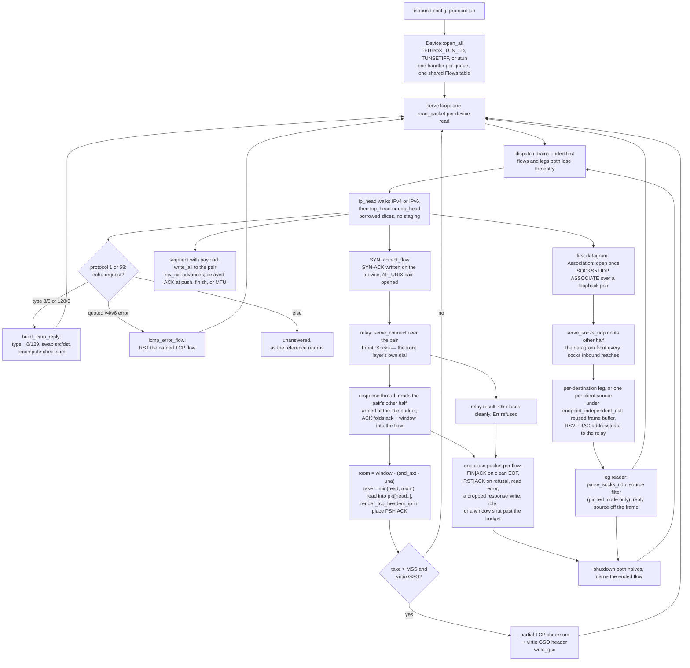

# TUN device inbound (native)

A `tun` inbound opens a virtual network device and reads raw IPv4 or IPv6 packets off it; every TCP flow the packets form becomes a proxy dial through the machinery the tree already had, every UDP flow becomes a datagram dial through the SOCKS5 UDP association the same front layer serves — one leg per destination, or one per client source under `endpoint_independent_nat` — an ICMP or ICMPv6 echo request is answered as the device's own destination would rather than dropped, and the bytes that come back leave again as IP packets on the same descriptor. Both roles the row has are served and both are proved: device-to-dial and dial-to-device. A flow also *ends*: the response read is armed at the idle budget, so a peer that stops speaking hands its thread, its pair and the relay leg it holds back instead of parking them for the life of the process; a clean proxy close finishes the device's half with `FIN | ACK`, and a refused leg or a broken pair resets it with `RST | ACK` instead of leaving an established socket with no peer. A quoted v4 or v6 ICMP error ends the TCP flow it names the same way, except a packet-too-big report, which lowers the flow's segment size instead; A Linux descriptor whose builder enabled TSO carries TCP GSO on the way back to the device: one large response read is rendered as one packet with a partial checksum and the kernel splits it at the MSS, while a non-GSO read is capped at the MSS so one read is one packet. The response direction is paced by the peer's own window: every device ACK folds `ack` and `window` into the flow, a write waits while `snd_nxt - una` fills the advertised room instead of flooding past a receive buffer this handler cannot retransmit into, and a closed flow wakes a parked writer so it resets rather than hangs. A multi-queue descriptor opens one handler per configured queue, and every handler passes the same flow table, so a segment the kernel hashes onto another queue still finds the flow its handshake opened instead of stalling it; only Linux exposes more than one queue, and a datagram leg stays on the queue its first datagram arrived on, because the association it frames onto is that handler's.

A device carries no wire byte-stream to diff, so this row's identity claim is the (target, payload) dial set: the pairs the inbound produces from a pinned packet stream must equal the pairs the pinned reference stack produces from it. The oracle is `scripts/tun-oracle` — smoltcp 0.12, the userspace stack the pinned zero-tun crate builds on — run over `script.txt`, and `the_dial_set_matches_the_pinned_stream` diffs the handler's own dials against the golden `expected.txt` that run recorded. The convention the golden pins (dial on handshake, deliver the reassembled payload in order, EOF at FIN) is also what xray's `proxy/tun/tcp_lightweight.go` reaches at `input`, `receive` and `ReadMultiBuffer`, and the SYN-ACK numbers follow its `newTCPConn` rule. The datagram half now rides the same oracle: `scripts/tun-oracle` also binds smoltcp's UDP socket and records the (target, datagram) set the reference stack delivers from `script.txt`, and `the_datagram_dial_set_matches_the_pinned_stream` diffs the (target, datagram) pairs the inbound hands its association against that golden. So the cases where UDP and TCP part ways — two bodies to one port staying two dials rather than one concatenated stream, a body shaped like a frame header surviving verbatim, an odd length delivered whole — are pinned against the reference run, not merely against the RFC 1928 frame `a_datagram_flow_frames_the_association_and_returns_the_echo` already asserts byte-for-byte.

The platform opens go through the same `tun-rs` builder the userspace stack uses, so the interface gets its configured address and prefix on Linux and macOS; the builder enables Linux `IFF_VNET_HDR` with `TUN_F_CSUM|TUN_F_TSO4|TUN_F_TSO6` when the kernel takes it, and an offload refusal retries the same spec without offload instead of failing the inbound. macOS utun packets keep their four-byte family word in front, and the Linux virtio header is stripped on read and rebuilt on write. An inherited descriptor (`FERROX_TUN_FD`) bypasses the builder — zero-tun's `inherited.rs` seam, which is also the only path a CI runner or a test can exercise, since no runner holds `CAP_NET_ADMIN`; `TUNGETIFF` tells it whether the Linux descriptor carries a virtio header, and because `IFF_VNET_HDR` does not say `TUNSETOFFLOAD` was accepted, an inherited descriptor strips the header on read but never emits GSO. The privileged opens are compile-checked only, and the tests drive an `AF_UNIX` `SOCK_DGRAM` socketpair through the same `read_packet`/`write_packet` pair the device does — datagram because a TUN delivers whole packets, and `SOCK_SEQPACKET` does not exist on macOS.

## Config

The reference TUN blocks are read in full. Applied: `name` or `interface_name` for the device; `mtu`; `address` as a string or a list with `inet4_address`/`inet6_address` as the older spellings and `prefix` filling a missing CIDR; `queues`, or `multi_queue` where `false` narrows to one queue and `true` keeps the platform's count; `stack`, where `gvisor` maps to the userspace engine and `mixed` to the hybrid one while `loopback` selects this native handler; `udp_timeout` as seconds or a Go-style duration (`500ms`, `1m30s`), which is the idle budget each datagram leg arms; `endpoint_independent_nat`, which keys a leg on the client source alone; and `gso: false`, which opens the device without the TCP offloads. Every other key the reference accepts — `auto_route`, `auto_redirect`, `strict_route`, the `route_*` sets, `dns_mode`, `netns`, `iproute2_*`, the `include_*`/`exclude_*` interface, UID, package and MAC filters, `udp_mapping`/`udp_filtering`/`udp_nat_max`, `platform` — loads and is named in one startup line as accepted but not applied, so a config written for another TUN front runs instead of being refused; a second address is named the same way, because the device carries one. What is refused is a malformed value: a non-boolean switch, a non-string or unparseable address entry (every listed prefix is parsed, not only the first), or a zero or unparseable `udp_timeout` fails before the device opens. Two limits are named rather than silent: `udp_timeout` and `endpoint_independent_nat` configure this handler, and a `gvisor`/`mixed` stack says so in one line and keeps its own datagram idle; and a leg whose reader timed out keeps its socket until the next packet drains the end notice, so a silent device holds one descriptor per source. With `queues` above one every queue reads one leg table, so a client source keeps one socket wherever the kernel hashes its datagrams, and the table is a mutex the first datagram of a source takes. `the_tun_spec_accepts_the_reference_spellings` loads a config carrying every key of the pinned sing-box block, `the_reference_stack_names_map_to_the_engines` pins the `gvisor`/`mixed` mapping, and `a_tun_field_with_the_wrong_type_is_refused` pins the refusals.

## Data path



## Measured

<!-- counts:begin -->
| key | value | checked by |
| --- | --- | --- |
| ops-retired-instructions | UNBLESSED | scripts/count-ops.sh |
| syscalls-per-tun-packet | UNBLESSED | no syscall checker yet |
| dial-set-flows-matching-the-pinned-stack | 3 | ferrox-app-tun::tests::the_dial_set_matches_the_pinned_stream |
| reverse-role-response-round-trips | 1 | ferrox-app-tun::tests::the_response_bytes_come_back_as_ip_packets |
| parse-copies-per-packet | 0 | ferrox-app-tun::tests::the_payload_is_borrowed_from_the_read_buffer |
| flows-handed-back-at-the-idle-budget | 2 | ferrox-app-tun::tests::a_quiet_tun_flow_hands_its_threads_back |
| flows-finished-with-fin-on-proxy-close | 1 | ferrox-app-tun::tests::a_closed_proxy_leg_sends_fin_after_its_bytes |
| refused-proxy-legs-reset | 1 | ferrox-app-tun::tests::a_refused_proxy_leg_resets_the_device_flow |
| datagram-association-round-trips | 1 | ferrox-app-tun::tests::a_datagram_flow_frames_the_association_and_returns_the_echo |
| datagram-parse-copies-per-packet | 0 | ferrox-app-tun::tests::the_datagram_is_borrowed_from_the_read_buffer |
| datagram-reply-packets-checksummed | 1 | ferrox-app-tun::tests::the_reply_packet_verifies_at_the_reference_reader |
| writes-after-a-refused-packet | 2 | ferrox-app-tun::tests::a_refused_packet_does_not_end_the_flow |
| datagram-dial-set-flows-matching-the-pinned-stack | 5 | ferrox-app-tun::tests::the_datagram_dial_set_matches_the_pinned_stream |
| icmp-echo-replies-verified | 1 | ferrox-app-tun::tests::an_icmp_echo_request_is_answered_as_a_reply |
| icmp-non-echo-messages-refused | 3 | ferrox-app-tun::tests::a_non_echo_icmp_message_is_refused |
| ipv6-tcp-packets-parsed | 1 | ferrox-app-tun::tests::an_ipv6_tcp_packet_parses_and_renders_with_its_checksum |
| ipv6-extension-headers-walked | 1 | ferrox-app-tun::tests::an_ipv6_extension_header_is_walked_to_the_transport |
| icmpv6-echo-replies-verified | 1 | ferrox-app-tun::tests::a_v6_echo_request_flips_to_a_v6_reply |
| icmp-error-quoted-flows-named | 1 | ferrox-app-tun::tests::an_icmp_error_quotes_the_flow_it_ends |
| virtio-gso-headers-written | 1 | ferrox-app-tun::tests::a_virtio_gso_header_names_the_tcp_segment |
| gso-frames-per-large-response-read | 1 | ferrox-app-tun::tests::a_large_response_read_leaves_as_one_gso_frame |
| emit-packet-reallocations-per-render | 0 | ferrox-app-tun::tests::an_emitted_packet_reuses_its_render_buffer |
| response-payload-copies-per-read | 0 | ferrox-app-tun::tests::a_response_is_rendered_where_the_relay_read_landed |
| flows-served-off-the-queue-that-opened-them | 1 | ferrox-app-tun::tests::a_flow_opened_on_one_queue_is_served_from_another |
| time-tcp-up-10 | ferrox=34.6Gbit/s,zeptun=36.1Gbit/s,ratio=0.96 | tun-bench.yml |
| time-tcp-down-10 | ferrox=33.9Gbit/s,zeptun=38.9Gbit/s,ratio=0.87 | tun-bench.yml |
| time-rr-8x1k | ferrox=70041tps,zeptun=107728tps,ratio=0.65 | tun-bench.yml |
| time-udp-100k | ferrox=97024pps,zeptun=99976pps,ratio=0.97 | tun-bench.yml |
| cpu-cores-at-tcp-down-10 | ferrox=2.33cores,zeptun=2.04cores | tun-bench.yml |
| rss-mb-at-ten-flows | ferrox=15.8MB,zeptun=6.2MB | tun-bench.yml |
<!-- counts:end -->

The first row is the identity claim itself: three flows — a request line, a four-byte blob, and a two-chunk payload whose lengths are not a segment boundary — dialed with exactly the (target, payload) pairs the smoltcp run recorded. The reverse-role row sends bytes out through the relay and requires them back as an IP packet carrying those bytes on the same descriptor. The copies rows are gated by pointer identity, not bytes: `the_payload_is_borrowed_from_the_read_buffer` and `the_datagram_is_borrowed_from_the_read_buffer` assert each parsed payload's base *is* the read buffer plus the fixed headers, because a byte test passes with a parsing copy and without one. The emit-reuse row is the same discipline on the other side of the device: `an_emitted_packet_reuses_its_render_buffer` warms one render and then requires the reused buffer's base pointer and `capacity()` to hold steady across a run of TCP and ICMP renders — the gate that a steady-traffic emit allocates nothing — and requires each reused render's bytes to equal a fresh build, which is what proves the reuse leaks no stale byte a throwaway vector would not have carried. The flows-handed-back row is the lifetime claim: two flows opened against a relay that reads to EOF and reports back — one ended by silence past the armed idle budget, one ended by the client's RST inside it — and both must report back, with the quiet flow's entry already gone from the table at the next packet and the reset flow's gone at once. Before the arm, a peer that stopped speaking left the response thread parked in an untimed `read(2)` for the life of the process: one thread, one pair, one relay leg and — under a `foxy` outbound — one tunnel and its lane, per dead flow, which is what a long `--vpn` session's thread count was climbing.

The close rows are the other half of that lifetime: `a_closed_proxy_leg_sends_fin_after_its_bytes` requires the proxy's payload first, then a `FIN | ACK` carrying the response cursor, and accepts the device's own `FIN` afterwards; `a_refused_proxy_leg_resets_the_device_flow` requires a refused relay to produce `RST | ACK` rather than silence. The relay seam returns `io::Result<()>`, so the response thread reads a clean close as `FIN` and an error as `RST`; an upload into a proxy half the relay already closed is written for whatever the pair accepts and the cursor follows it, so the device is never acked for bytes the relay did not take, while the read leg finishes the flow at its next EOF so a reply the relay wrote before closing still reaches the device, and one shared flag keeps a flow to a single close packet whichever thread sees the end first. The refusal is observed through the same dial entry every other front uses (`dial_or_report`), so a device flow whose TCP dial is refused is reset instead of reported as a clean close.

A packet the device refuses is the packet that is lost, not the flow. `write_packet_to` writes one packet with `write`, or `write_pair` with one `writev` when a utun/virtio header rides in front, retries an `Interrupted` signal, drops a short write or an `EINVAL`/`EMSGSIZE` refusal, and returns the error only for a device-level failure; every control emit ignores the verdict, so a dropped SYN-ACK, ACK or close packet does not end the flow it belongs to, and the datagram leg reader breaks only on that error because a dropped datagram is only that datagram. A response cannot take that verdict: the bytes are already consumed off the relay's socket into the packet's payload hole and this handler keeps no retransmit buffer, so continuing would send the next read's bytes at the dropped segment's sequence — that is a hole no retransmit buffer here can fill, so the response loop resets the flow instead. `a_refused_packet_does_not_end_the_flow` refuses the first write and carries the second, which is the row `writes-after-a-refused-packet 2` — the same verdict the smoltcp stack's `a_refused_packet_is_dropped_and_the_next_still_goes_out` pins on the other front; `an_interrupted_packet_write_is_retried` covers the transient signal.

The multi-queue row is the shared table's gate: a SYN opens a flow on the first handler, a payload segment arrives on a second handler's descriptor, and that second queue must hand the bytes to the first flow's relay and acknowledge the segment itself — a queue with its own table would drop both. The payload's trim and its receive-cursor store sit inside the pair's lock, so two queues handed the same flow at the same moment cannot write its bytes twice; `an_ack_at_the_sent_cursor_moves_the_window` pins the pacing side of it — a partial ACK moves the acknowledged cursor, an ACK naming bytes the device was never handed does not. The datagram rows are the same claim on the other front: one flow that frames onto the association and returns the echo, with the frame asserted byte-for-byte (`[0,0,0,1,198.51.100.7,0,53] ++ b"who-is"`) and the answer required to carry both checksums a peer's stack verifies. The dial-set row is the reference half of it: five datagrams rendered from `script.txt` are handed to a recording association, each frame parsed back to its (target, datagram) pair, and that set required to equal the five `UDIAL` lines smoltcp's UDP socket recorded — the no- coalescing case (`61626364`, `6566` staying two dials where the TCP flow above concatenates them) is the one this row and no frame-only test can see. A leg is reaped by the same channel: silent past `budgets::udp_idle()`, its reader shuts, names its key, and `dispatch` drops the socket it held.

The ICMP rows are the third protocol `dispatch` answers: an IPv4 or IPv6 echo request (type 8/0 or 128/0) is returned as an echo reply — the message's type flipped to 0 or 129, its identifier, sequence and data carried back unchanged, its checksum recomputed and its IP header rebuilt with source and destination swapped — witnessed by `an_icmp_echo_request_is_answered_as_a_reply` and `a_v6_echo_request_flips_to_a_v6_reply`. A reply to a non-request, a message with a non-zero code, or one shorter than the eight-byte ICMP header is left unanswered, the same three refusals `a_non_echo_icmp_message_is_refused` pins — matching the reference's `handleICMP`, which returns without writing anything it would not answer as an echo. The IPv6 rows walk an extension header to the transport and render a v6/TCP packet whose checksum a receiver verifies, while `an_icmp_error_quotes_the_flow_it_ends` and `a_v4_icmp_error_quotes_the_flow_it_ends` name the flow a v4 type 3 or v6 type 1/2 error quotes — the quote is the router-to-device packet this handler wrote, so its source and ports are read in reverse. A type 3 code 4 or type 2 report is a path-MTU verdict, not a death: `reported_mtu` clamps it to 576 or 1280, `path_mss` leaves the headers and the 48-byte floor, and `shrink_flow` only lowers the flow's segment size, so later responses fit the path while the flow stays open; `a_packet_too_big_shrinks_the_response_segment` drives a real handshake, sends the report, and requires the flow's MSS to fall from 1460 to 1160. Other v4 type 3 and v6 type 1 errors still reset the flow. `a_virtio_gso_header_names_the_tcp_segment` pins the native-endian virtio fields a Linux GSO write carries, and `a_large_response_read_leaves_as_one_gso_frame` drives a real handshake through the response thread: a 4 000-byte read off a 100-byte-MTU flow must leave as one frame with `NEEDS_CSUM`, `GSO_TCPV4`, its MSS as the split size, the whole payload, and a partial field equal to the pseudo-header sum in network order — the field value a header-only test cannot see because it never carries a segment for the kernel to add.

Syscalls: the serve loop is one `read(2)` per raw packet, or one `readv(2)` that strips a utun or virtio header, and one framed `write(2)`/`writev(2)` per emitted packet — SYN-ACK, pure ACK, response, ICMP reply — plus one `socketpair(2)` per flow to open the `AF_UNIX` pair (a listener plus `connect`/`accept`, three sockets, on a non-Unix host), one `setsockopt` per flow to arm the response read at the idle budget, one close `write(2)` (`FIN` or `RST`, never both) and one `shutdown` per flow when it dies. A GSO write adds one header to the same write; it does not split the packet. A window-blocked response parks on the thread's own parker and is woken by the next ACK, so pacing adds no syscall and no timer. A loopback socketpair test cannot gate a syscall total, so the row stays `UNBLESSED` and the shape is prose. The one allocation the emit path makes is named under what was not removed. Time: not measured locally, see below.

## Ops

```bash
./scripts/count-ops.sh report \
  tun::tests::the_dial_set_matches_the_pinned_stream 'tun::Handler::dispatch'
```

`UNBLESSED`, as above — macOS/aarch64 ships no `valgrind`, so this count is CI-only there and has not been read; it is not a number and is not quoted as one.

## Time

The `ferrox-native` engine rides `tun-bench.yml` with four queues over one shared flow table, 10 s and three repeats, medians. Run 43652352496 (Xeon 6975P, plain-TCP probe `23.7 Gbit/s`) read tcp-up-10 `34.6 Gbit/s` against zeptun `36.1` (0.96), tcp-down-10 `33.9` against `38.9` (0.87), rr-8x1k `70 041 tps` against `107 728` (0.65), udp-100k `97 024 pps` delivered (97.0 %) against `99 976` (100.0 %), CPU at the down cell `2.33` cores against `2.04` (`1.03` against `0.29` at the udp cell), and RSS at the ten-flow cells `15.8 MB` against `6.2 MB`. A runner is not a constant: run 43646648157 (a throttled EPYC 7763 whose probe read `11.3`) read the same four cells as `17.6` / `19.0` / `25 584` / `60 684` against `22.9` / `23.5` / `34 197` / `99 970`, and run 43640803132 (EPYC 9V45, probe `21.9`) as `30.9` / `31.4` / `41 977` / `99 539` against `39.0` / `39.5` / `61 018` / `99 973`, so the ratio inside one run is the comparable figure and the absolute median belongs to the machine that produced it.

The matrix also runs `hev-socks5-tunnel` (`8e3b4cd7`) and sing-tun through sing-box 1.14's `gvisor` and `system` stacks, so the row is read against every reference it names: run 43696389337 read hev `14.8` / `38.4 Gbit/s`, `53 674 tps`, 100 % udp and `8.8 MB`, both sing-tun stacks under `3.1 Gbit/s` at `59–112 MB`, and native `14.2` / `30.5 Gbit/s`, `42 338 tps`, 99.3 % and `15.5 MB` on the same runner. The resident floor is code rather than heap: `rss-ferrox-native.txt` in that run's artifact puts `10.7 MB` of PSS in this binary's own executable pages and under `1 MB` in `[anon]`, against zeptun's `0.8 MB`, so the `rss-mb` cell reads the touched text pages of the whole app and the per-flow cost this handler adds is the flow table and its buffers.

The first dispatch (run 43595990881, one queue) read tcp-up-10 `9.104`, tcp-down-10 `0.001` and rr-8x1k `21 278`: the down cell was a receive-window stall (no pacing, no retransmit) and the parallel cells were one reader. Both are fixed — an ACK folds `ack`/`window` into the flow and the response thread parks on the room it leaves, and `queues` opens one handler per queue over one flow table — and the run that first exposed the stall now carries it whole.

The deficit that remains is structural and is named rather than averaged away. A flow rides one `AF_UNIX` pair (a loopback TCP pair only on a non-Unix host) onto `serve_connect`, so every byte crosses two descriptors more than the reference's inline translator; the CPU columns say it plainly, at 1.1–1.8× zeptun's cores for the same TCP bytes across the three runs. The down cell is 0.87 for that cost plus no cwnd and no retransmit behind a drop; rr pays it on both halves of every transaction (0.65) and on the one wake per response the pair delivers through a second thread; udp-100k delivers 0.97 and pays 3.5× zeptun's cores for it (`1.03` against `0.29`), because the leg is a thread and two socket hops — on a throttled runner that cost is what turns into drops (60.7 % in run 43646648157). Closing any of it means the handler owning the outbound socket, which the front does not expose: `serve_connect_at` fuses each outbound's dial with the relay that serves the client, and the carriers that read the client's own bytes need that split to keep a stream end. That seam is its own slice and is the next thing this row owes; the pair is what this page can take to the comparator today. A device read over a real interface involves the kernel routing the packet, and every contributor machine sits behind a VPN — a local dial would measure that, not this code.

## What we removed

Against the pinned references, which is where the bar is:

- **The whole userspace stack, for the traffic a relay can answer without one.** Xray's `proxy/tun/tcp_lightweight.go` is ~1 000 lines: `hold`/`loss` reassembly lists, SACK blocks, an RTO timer goroutine per connection, delayed-ACK and PTO timers, and window growth. zero-tun instantiates a real smoltcp `TcpSocket` per flow with 32 KiB rx/tx buffers, and sing-box's tun runs its own netstack over its device API. This inbound keeps three numbers per flow — `rcv_nxt`, `snd_nxt`, `last_acked` — one delayed-ACK rule (answer at a push, at the finish, or once a full MTU has gone unacknowledged, never for a segment that brought nothing), and no timer at all. What was kept is the convention the differential can see and the handshake-number rule of `newTCPConn`; the stack machinery was removed down to the smallest thing that still produces the reference's dial set, and the removed reassembly and retransmit are named below rather than claimed away. The same rule holds the flow's *lifetime*: xray keeps a reassembly list and an RTO goroutine per connection and smoltcp a socket timer per flow, here one armed `SO_RCVTIMEO` on the pair's read half plus a channel of ended keys expires a quiet flow and reaps it — no timer, no reaper thread, and no clock read in the serve loop.
- **A second dialer.** The tun2socks shape this tree could have grown is a bespoke outbound call from the packet handler. It does not: `accept_flow` opens one `AF_UNIX` socket pair (a loopback TCP pair only where the host has no `AF_UNIX`) and calls the same `serve_connect(conn, out, dest, Front::Socks, &[])` every other front reaches, and `handle_udp` opens one loopback association whose other half runs the same `serve_socks_udp` the SOCKS inbound reaches — the greeting, the `UDP ASSOCIATE` request and the relay-address reply are the bytes a SOCKS5 client writes, so the outbound's UDP arms cannot tell a device from a proxy client. The destination from the IP header rides the existing front either way and no protocol code is duplicated — the idea zeptun sells (translate the device onto the SOCKS machinery, do not re-implement it), taken without its translator thread. The pair carries no IP tuple, so a front that asks its client for a peer address — an access log's source, a process-owner rule — now gets none for a device flow instead of the loopback pair's `127.0.0.1`, which named the handler's own far end rather than the device's source. `is_device` refuses `utun`/`wintun`/`tun2socks` as *protocol* names while serving `tun` with all three device spellings, so the config surface keeps one way in.
- **The parsing copy.** The references stage each packet: xray's stack reads through a `buf.Buffer` it copies into segments, smoltcp parses into its own `IoBuffers`. Here `ip_head` (IPv4 or IPv6) and `tcp_head` hand back slices *of the read buffer*, the payload goes from that borrowed slice straight into the pair's `write_all`, and the pointer-identity rows above are the gate. A segment with TCP options parses at its real data offset (`a_syn_with_options_leaves_the_payload_where_the_header_ends`), and a forged length or short header is refused, not repaired (`a_forged_packet_is_refused_not_repaired`, `udp_head_refuses_a_forged_length`).
- **The extra datagram leg under `endpoint_independent_nat`.** A per-destination mapping opens one UDP socket, one reader thread and one `udp_buffer()` for every (source, destination) pair; the reference's endpoint-independent mode keys the mapping on the source alone, so a client talking to five destinations holds one leg and five framed destinations. `an_endpoint_independent_leg_serves_every_destination` drives two destinations from one source and requires one entry in the leg table and one reply per destination, with each reply's IP source read off the frame the association wrote; `the_default_datagram_leg_is_per_destination` pins the default shape at two legs.

- **The datagram reply's buffer.** `open_leg` renders each answer with `connectip::udp_datagram` into one `Vec` allocated before the thread starts and `clear()`ed per packet, and `handle_udp` frames onto the association through the handler's reused buffer, so a steady-state datagram both ways allocates nothing. Reusing the read buffer for the outbound frame would need a vectored send, and the row does not count that yet.
- **The emitted packet's allocation, zero-fill, and pseudo-header copy.** Every device-bound packet — SYN-ACK, pure ACK, response, ICMP reply — used to render into a fresh `vec![0u8; ip_len]`, and the TCP builder materialised the twelve-byte pseudo-header into a *second* heap `Vec` and copied the whole segment into it just to take the checksum. Now `render_tcp_packet`/`render_icmp_reply` extend stack-built headers and the payload into one caller-owned reused buffer — the handler's `emit`, the per-flow response thread's `pkt` — so steady-traffic emit neither mallocs nor reallocates, gated by `an_emitted_packet_reuses_its_render_buffer` (`emit-packet-reallocations-per-render 0`: capacity and base pointer held across a run of TCP and ICMP renders, each byte-identical to a fresh build). The pseudo-header is not written at all: the segment is checksummed in place by the streaming `connectip::tcp_checksum`, which `the_tcp_checksum_is_the_materialised_pseudo_header_words` requires to equal the old materialised-header sum at every segment length, odd tail and all-ones carry chain included. No pass got worse — the only bytes still written are the payload `extend` every reference also does, and the one-per-buffer growth is an establishment cost, not a per-packet one.
- **The ICMP responder, trimmed to echo and the errors a flow needs.** The references grew a wider ICMP surface — the Windows WFP path carries neighbour and multicast-listener discovery (types 130–137, 143), and smoltcp runs a full `Ipv4RawSocket`/ICMP socket per interface. This inbound answers the thing a `ping` off the device needs, over either version: an echo request reflected as an echo reply, reusing the lane's own `checksum`/`ipv4_checksum` and a single borrowed message read — no socket object, no discovery protocols, no rate limiter. It also reads the quoted packet in a v4 type 3 or v6 type 1/2 error: a packet-too-big report lowers the TCP flow's MSS as xray's `undelivered` does, and any other error resets the flow. The reply rides the reused emit buffer `render_icmp_reply_ip` extends into, so an answer allocates nothing per ping beyond the buffer the handler already holds.

## What was not removed

Named rather than claimed, with the worst input worked out first:

- **Per-flow and per-handler buffers, grown once.** The response thread holds one buffer for its flow's life — the packet itself, its payload read straight into the hole the headers leave — sized for one IPv6/TCP header past the MSS when GSO is off, or the full packet window when it is on; the handler's reused `emit` grows to a first oversized packet. These are per-flow and per-handler, not per-packet — the steady-traffic emit the reuse row counts is allocation-free, and only flow establishment pays. A shared slab across the handler and its response threads would need an owner and a lifetime the single-`emit`-per-thread shape does not carry, and nothing here has justified that yet, so it stays a named cost.

- **The pair itself, and the two descriptor crossings it costs.** The pair is now one `AF_UNIX` socket pair on a Unix host rather than a loopback TCP listener plus `connect`/`accept`, which is one `socketpair(2)` per flow instead of three sockets and four calls, and a byte path with no loopback TCP stack, no Nagle and no receive-window pacing of its own; the payload bytes and the half-close still travel as the stream the relay expects. What is *not* removed is the crossing: a flow's bytes still cross the pair in each direction, so the response path is three descriptors deep (outbound, pair, device) where a translator that owned the socket would be two, and the upload path is the same shape. That is two extra `read`/`write` calls and two extra copies per byte against zeptun's inline stack — the measured 1.3–1.9× CPU per byte — and it is why this row lands below the comparator. Two back-to-back CI runs on the same defaults measure the swap itself flat — run 43677090881 without it against 43674964575 with it: `tcp-down-10` 18.593→19.481 Gbit/s, `rr-8x1k` 25 392→26 402 tps, `tcp-up-10` 17.541→16.207 Gbit/s, while the comparator moved +2.5% to +5% over the same pair — so what this step banks is the per-flow socket count, and the duration cell stays where the crossing puts it. Removing it needs a dial-only seam: `serve_connect_at` fuses each outbound's dial with the relay that serves the client, so a handler that owns the upstream has nothing to call until the front exposes `dial_outbound` and a fallback for the carriers that must read the client's own bytes. That is a front slice, not one this page can take without a second dialer.
- **Reply-side coalescing and inherited GSO.** A builder-enabled Linux descriptor coalesces one response read into one GSO write and lets the kernel split it at the current MSS; a non-GSO descriptor writes one MSS-sized packet per read, and its device reads stay one packet each. An inherited virtio descriptor is not told to emit GSO because `IFF_VNET_HDR` alone does not prove the kernel accepted `TUNSETOFFLOAD`. A framed write is one `writev`, and a short result drops the packet rather than sending its tail as a second.
- **One relaxed store per payload-bearing packet.** `busy` is set where the upload is written, because the reap has to tell a live flow from one the device merely retransmits to; a per-packet clock read would be the same cost paid by *every* packet instead of only the ones carrying payload, and a timer per flow is the machinery this row already removed.
- **The close reads the relay's verdict once.** The relay thread keeps a duplicate of the pair's far end until it has queued `Ok`/`Err`, so an EOF seen before a verdict is a remote clean close (`FIN`) and a refusal always queues `Err` first (`RST`); no timeout is waited per close. The handler's own reset path and the response thread's share one `signaled` flag, so a flow emits one close packet whichever end is seen first.
- **The reap rides the next packet.** An ended key is drained in `dispatch`, not by a reaper: a dead flow whose device sees no further packet keeps its table entry until one arrives. Two threads and a socket pair do return at the budget — the entry is the smaller half of what a quiet flow holds, and it is held by the one thread that owns the map.
- **Out-of-order segments are dropped, not buffered.** The handler delivers only the bytes at `rcv_nxt` or overlapping it, trimming the leading bytes it already has, and drops a segment that starts ahead of `rcv_nxt` so the device retransmits it in order. A duplicate never reaches the proxy twice, but there is no hold list: xray keeps segments off sequence and smoltcp buffers them, and that reassembly is still the next TCP slice.
- **UDP segment offload is turned back off.** The kernel offers `TUN_F_USO4|TUN_F_USO6` with the TCP offloads, but an aggregate is not split here, so `tcp_only_offload` narrows the mask to `TUN_F_CSUM|TUN_F_TSO4|TUN_F_TSO6`; a kernel that refuses the narrower mask falls back to no offload rather than serve a coalesced datagram as one.
- **One mutex around the flow table.** Every queue reaches the same `HashMap` through one `Mutex`, so a segment costs a short uncontended lock before its payload is written and the lock is released before any device write; the response threads never take it. A sharded table or a per-flow channel would trade that lock for a key distribution and a lifetime this row does not need yet, so the lock is named, not hidden.
- **No retransmit, no congestion, and only the peer's window as pacing.** Each flow advertises a constant 65535 and paces a response to the room the device's ACKs leave (`window - (snd_nxt - una)`), parking the response thread on the window rather than flooding a receive buffer it cannot retransmit into; a zero-window probe from the peer reopens it, and a window shut past the idle budget resets the flow. There is still no cwnd, no RTO and no retransmit: a segment the device drops is lost until the reference's timers would have resent it, and the references timer-retry.
- **The SYN-ACK sequence is `syn+1`, not a random ISN.** `newTCPConn` picks `rand.Uint32()`; a golden cannot pin a random number, the dial set does not depend on it, and the wrap case is gated instead by `the_syn_ack_numbers_wrap_at_the_sequence_space_boundary` (`u32::MAX-1` replies `u32::MAX`).
- **ICMP discovery is outside this row's native surface.** Echo is answered over v4 and v6, a packet-too-big report lowers the flow's MSS, and any other quoted v4/v6 error resets the flow it names. The neighbour/multicast discovery messages are answered only by xray's Windows WFP path, not by its native TUN stack, so they stay out of this row rather than becoming a second ICMP surface; `dispatch` also mints no destination-unreachable of its own.
- **The golden feeds whole datagrams and names none empty or oversized.** The oracle now runs smoltcp's UDP socket as it runs its TCP socket, so the outbound (target, datagram) set is a reference-vs-Ferrox differential, not a spec-frame assertion. Two shapes that differential cannot witness: a datagram over the device MTU, which smoltcp would fragment and the handler sends as one, and an empty one — neither is in `script.txt`, so neither is claimed.
- **The association is proved against a stand-in that speaks the spec.** `echo_associate` answers the greeting, the `UDP ASSOCIATE` request and the relay-address reply the way `serve_socks_udp` does, and the shipped inbound wires that function; what no test here reaches is a datagram that leaves the tree to a real target.
- **The routing, firewall and filter keys.** `auto_route`, `auto_redirect`, `strict_route`, the `route_*` sets, `dns_mode: hijack`, `netns`, `iproute2_*` and the process, package and MAC filters are parsed and named in one startup line, not installed: the routes a device needs belong to the host, and this row does not re-implement the reference's netlink writer or its nftables redirect. A config that carries them runs with the device address it names and the routes the operator already has, and the startup line is what keeps the gap named rather than silent.
- **The privileged opens are compile-checked only.** No CI runner holds `CAP_NET_ADMIN`, so nothing runs `TUNSETIFF` or the utun control connect; the inherited-fd path is the one the tests and any real CI use, and that no run-check exists for the ioctls is stated here, not glossed.

## Pins

| what | where |
| --- | --- |
| the handshake numbers and dial convention | `upstream/xray-core/proxy/tun/tcp_lightweight.go` |
| the stack the oracle runs, and the inherited-fd seam | `upstream/zeronet/crates/zero-tun` |
| the device API and netstack shape the row trims | `upstream/sing-box/protocol/tun`, `upstream/sing-box/transport/device` |
| the translate-onto-SOCKS idea, not its translator | `upstream/zeptun` |
| the recorder that produced `expected.txt` | `scripts/tun-oracle/main.rs` |

## CI scope

What a change here owes, read by `scripts/ci-scope.py`; see [`docs/ci-scope.md`](../ci-scope.md).

<!-- scope:begin -->
- paths: crates/ferrox-app/src/tun.rs
- symbols: tun
<!-- scope:end -->
