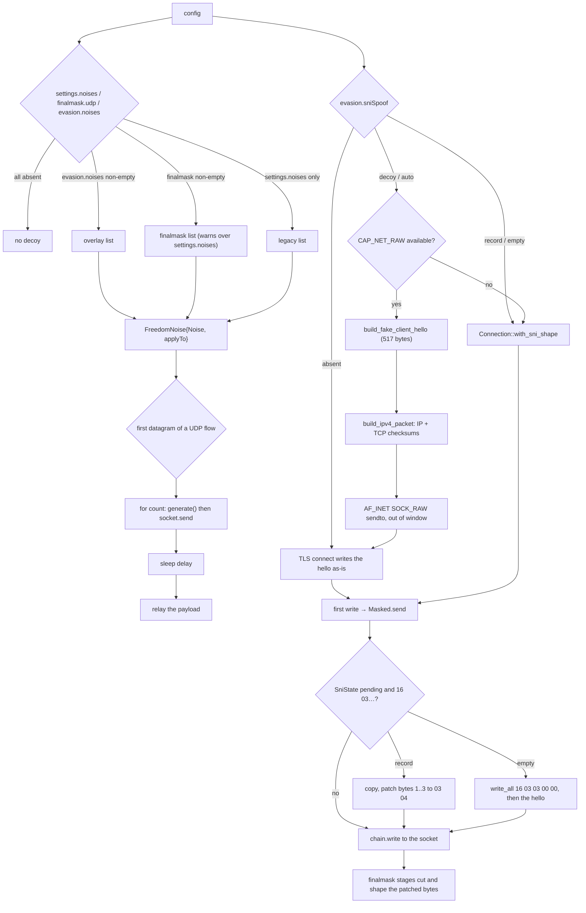

# Evasion on TCP/TLS: UDP noise and fake-SNI

The reference's `zero-evasion` layer hides a flow from a filter that reads it, and this tree
carries two of its knobs. A freedom outbound's UDP lane sends a configured decoy list before its
first datagram, and a TLS outbound's `evasion.sniSpoof` sends a decoy `ClientHello` naming a
different server ahead of the real one. The remaining TCP knobs are their own rows: the record cuts
are `obfs-fragment-tlssni` (README row 172) and the idle probe and lane retirement are
`engine-keepalive` (README row 174). The no-root fake-ClientHello lane is `obfs-sni-spoof`
(README row 114) and is not claimed here.

A `noise` list reaches the UDP writer through three spellings, read in the reference's order:
`settings.noises` (the legacy freedom schema), `finalmask.udp[type=noise].settings.noise`, and
an outbound-level `evasion.noises` overlay. A non-empty `evasion.noises` replaces the other two,
a non-empty `finalmask` list replaces `settings.noises`, and a config that names both
`settings.noises` and `finalmask` gets one warning and the finalmask list, which is the
reference's own verdict rather than a refusal. Every entry keeps its `type` (`rand`, `str`,
`hex`, `base64`, `array`, `quic`), its `packet`/`rand`/`randRange` bytes, its `delay`, its
`count` (default one) and its `applyTo` family filter. `rand` draws a length in `packet`'s
half-open range and fills it with bytes from `randRange` (default `0-255`); `quic` draws from
`packet` (default `5-10`) but never sends fewer than 25 bytes, the smallest long-header Initial
its fixed fields need, and writes that shape; the fixed types write their own bytes. A drawn
length whose upper end can exceed the family's UDP payload limit is refused at parse time, as is
a fixed packet longer than it, and `count` sends that many datagrams per entry, each followed by
the entry's wait.

`sniSpoof` is an outbound-level `evasion.sniSpoof` block on a TLS outbound. `method` is `auto`,
`decoy`, `urgent`, `fastopen`/`tfo`, `record`/`recordversion` or `empty`/`emptyrecord`;
`fakeSni` (or `fake_sni`) is 1..=219 visible bytes and defaults to `www.speedtest.net` for the
methods that need no decoy, where `?`, `#` and `*` draw a letter, a digit or either once per
dial; `sequence` is the decoy segment's sequence number; `fooling` is `auto`, `md5` or `ttl`, and
a `ttl` fooling takes `ttl` (default 8, and zero is refused). The decoy is a fixed 517-byte
`ClientHello` naming `fakeSni`, built with five cipher suites and the SNI, groups, point formats,
signature algorithms, supported versions and a key-share extension, then padded; the IPv4 packet
and TCP checksums are computed over the segment, and it leaves a fresh `AF_INET`/`IPPROTO_RAW`
socket that copies the dialled socket's mark and bound device, so the decoy takes the same route
as the real hello. `auto` and `md5` add the 18-byte TCP signature option (kind 19), signed with
no key, which a peer that never agreed on one drops; `ttl` leaves the option out and writes the
hop limit into the IPv4 header, because a raw socket with a supplied header sends that header
rather than the socket's `IP_TTL`, and recomputes the header checksum.

Where the kernel lets the process send a raw segment (Linux with `CAP_NET_RAW`), `auto` and
`decoy` send the fake hello outside the connection's sequence window before the handshake and
write the real hello untouched. Where it does not, and on every other platform, both fall back to
the `record` rewrite and print one warning per process; `urgent` and `fastopen` print one warning
and take the same fallback, because this tree does not implement them. The record rewrite is armed
on the same `Connection` the handshake writes through, ahead of the `finalmask` chain and of an
`xmc` session's payload write, and pads
the version in the first TLS record header from `03 01`/`03 03` to `03 04` once per stream; a
write that does not open a TLS handshake record is left alone and leaves the rewrite armed for
the next one, so a one-byte cut cannot spend it. The `empty` method writes one five-byte empty
handshake record (`16 03 03 00 00`) ahead of the hello instead.

The rewrite lives in `Connection::Masked` (`crates/ferrox-app/src/conn.rs`) as an `Arc<SniState>`
shared by every handle of the stream. The record is shaped before the chain — or an `xmc`
session — sees it, so a stage
that cuts the hello still sends the patched header, and a relay leg that cloned the mask keeps
the same one-shot state. A config naming no `finalmask` still gets the wrapper, with an empty
chain, because the rewrite is a property of the dial rather than of a mask.

## Data path

## Measured

<!-- counts:begin -->
| key | value | checked by |
| --- | --- | --- |
| fake-hello-octets | 517 | ferrox-core-evasion::tests::a_fake_hello_is_the_fixed_packet_and_carries_its_name |
| fake-sni-max-bytes | 219 | ferrox-core-evasion::tests::a_fake_name_outside_the_bound_is_refused |
| decoy-segment-checksums | 2 | ferrox-core-evasion::tests::a_decoy_packet_has_both_checksums_right |
| noise-packets-per-count | 3 | ferrox-app-proxy::tests::a_noise_count_sends_that_many_packets |
| noise-entry-kinds-parsed | 5 | ferrox-app-proxy::tests::a_freedom_noise_keeps_its_packet_and_family |
| noise-overlay-precedence | 1 | ferrox-app-proxy::tests::a_finalmask_noise_wins_over_the_legacy_list |
| record-header-version-bytes | 2 | ferrox-app-conn::tests::a_record_shape_rewrites_one_header |
| empty-record-octets | 5 | ferrox-app-conn::tests::an_empty_shape_precedes_one_record |
| noise-ops-retired-instructions | UNBLESSED | scripts/count-ops.sh |
| decoy-ops-retired-instructions | UNBLESSED | scripts/count-ops.sh |
| noise-syscalls-per-flow | UNBLESSED | scripts/count-ops.sh |
| decoy-syscalls-per-hello | UNBLESSED | scripts/count-ops.sh |
| noise-copies-per-packet | UNBLESSED | scripts/count-ops.sh |
| evasion-time | UNBLESSED | bench.yml |
<!-- counts:end -->

## Ops

`fake-hello-octets`, `fake-sni-max-bytes`, `decoy-segment-checksums`, `noise-packets-per-count`,
`noise-entry-kinds-parsed`, `noise-overlay-precedence`, `record-header-version-bytes` and
`empty-record-octets` are quantities the named tests assert themselves: the builder's fixed
length, its name bound, the two checksums a decoy segment carries, the datagrams a `count` sends,
the five kinds one parser test feeds, the one list that wins an overlay, the two version bytes a
record rewrite replaces, and the five bytes of the empty record. None is a syscall or an
instruction count.

`noise-ops-retired-instructions` and `decoy-ops-retired-instructions` stay `UNBLESSED`: no
valgrind probe prices either path yet, and `ops.yml` is the only reader that could turn them into
numbers. `noise-syscalls-per-flow` is `UNBLESSED` for the same reason, and because a flow's
`count` and `delay` are the config's own schedule, so a measurement must drive a fixed list
rather than a config. `decoy-syscalls-per-hello` is `UNBLESSED`: the decoy needs a Linux kernel
that grants `CAP_NET_RAW`, which no local run in this tree has. `noise-copies-per-packet` is
`UNBLESSED`: the fixed kinds hand back their own bytes by clone, and the drawn kinds build their
buffer from entropy, so the interesting copy is the UDP writer's, which is not yet priced.

## Time

**No row measures this lane.** `evasion-time` is `UNBLESSED` by `bench.yml`: neither `bench.yml`
nor `parity.yml` has an evasion cell, and a noise entry's `delay` is a sleep the config asked for,
so timing the path would price the schedule and the tunnel, not the code. The decoy's only
duration is the raw `sendto`, which is one segment either way. What the slice is gated on instead
is byte-identity and refusal: the checksum test holds the segment's bytes to the RFC's own
checksum vector, and the parser tests hold every accepted form and its refusal.

## What each reference gave

- **zeronet** `zero-evasion/src/sni_desync.rs`, `decoy.rs`, `record.rs`, `urgent.rs`,
  `noise.rs`, `rand_between.rs` and `zero-config/src/xray_json.rs` — the `sniSpoof` field set and
  its defaults, the five methods, the 517-byte fixed decoy hello with wildcard names, the record
  version rewrite, the empty record, the noise kinds, `count`, `randRange`, `quic`, the
  `finalmask.udp` spelling and the `RandBetween` bounds. Its urgent byte and fast-open paths are
  not taken; this tree warns and falls back instead.
- **xray-core** `transport/internet/finalmask` and `infra/conf/transport_finalmask.go` — the
  `finalmask.udp[type=noise]` container that `finalmask.md` already owns, and the `settings.noises`
  freedom schema this tree's parser already read.
- **LxBox** `docs/spec/features/016-DPI_HARDENING/` — mixed-case names, TLS fragmentation and
  uTLS/ECH, all of which are the record-cut and shaped-hello rows, not this one.
- **sing-box** `option/tls.go` — nothing taken: its fragment flags sit above TLS, a different
  surface.
- **aether, xray-core-rust, xray-rust** — nothing taken for this row; their handshake noise
  profiles and conformance seams belong to the rows named above.

## What we removed

- **A `ClientHello` builder per dial.** The reference assembles the decoy template into a fresh
  `Vec` for every connection. This tree builds the same 517 bytes from one function into one
  buffer whose capacity is the fixed packet length, draws the random and session id in place, and
  pads to the bound, so the decoy's size is a constant rather than a function of the name.
- **A decoy on a route of its own.** A synthetic segment leaves through its own raw socket, and
  a raw socket with no mark or bound device can exit where the real hello does not. This tree
  copies the dialled socket's `SO_MARK` and `SO_BINDTODEVICE` first, and when either copy is
  refused it sends no decoy rather than one a mark or interface rule would sort differently.
- **A per-stream wrapper for the record rewrite.** The reference wraps the connection in its own
  desync object. This tree stores one `Arc<SniState>` on the existing `Connection::Masked` and
  shapes the record before the chain, so an unconfigured connection pays no wrapper, a configured
  one pays one atomic swap, a fragmenting stage cannot spend the rewrite on a short cut, and a
  cloned relay leg shares the same one-shot state.
- **The urgent byte and the hello in the SYN.** Both are named as not implemented and take the
  record fallback with one warning. They are not silently skipped: a config that asks for them
  still sends a hello, and the console says which method stood in.
- **A refusal where the reference warns.** The reference refuses a config that names both
  `settings.noises` and `finalmask.udp` noise. This tree warns in one line and prefers the
  finalmask list, because the drop-in rule says a working config keeps working.

<!-- scope:begin -->
- paths: crates/ferrox-core/src/evasion.rs
- symbols: evasion, arm_sni, warn_sni, inject_sni_decoy, FreedomNoise, parse_freedom_noises, parse_noise_list, parse_finalmask_noises, parse_freedom_noise, freedom_base64, freedom_byte_range, freedom_array, outbound_sni_spoof
- scenarios: vless-tls-raw
<!-- scope:end -->
