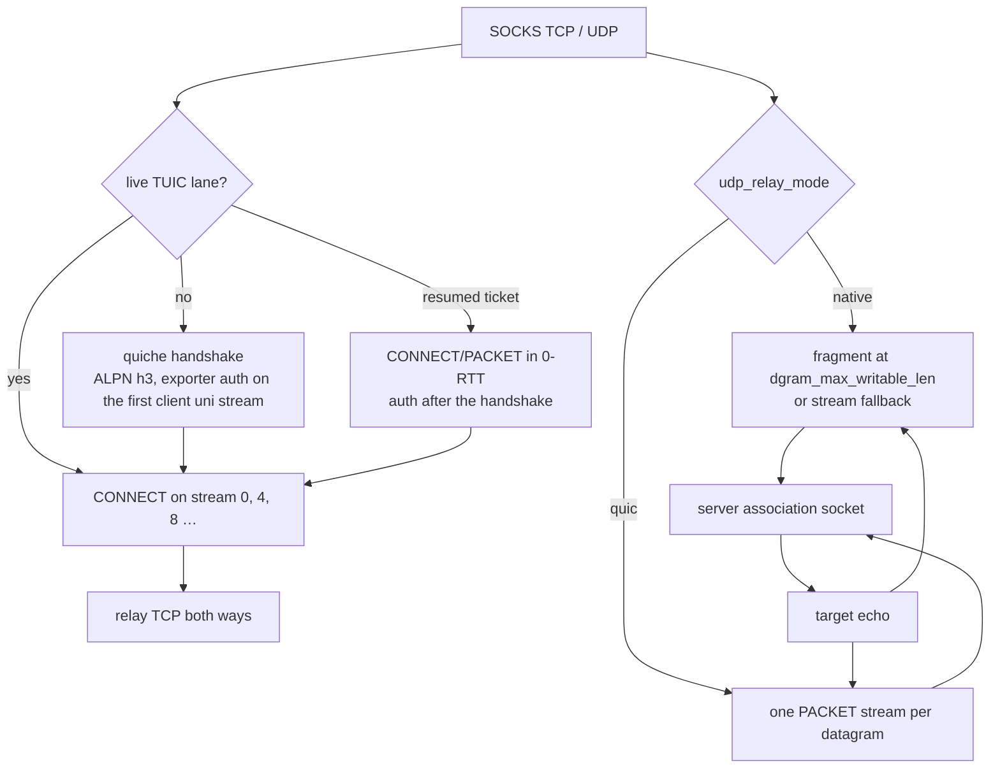

# TUIC v5 over QUIC

TUIC v5 is a QUIC protocol with one authenticated unidirectional stream, bidirectional CONNECT streams and a PACKET lane. Both roles are served: a `protocol: tuic` inbound reads `settings.users`/`clients`, while an outbound reads the first `settings.servers` entry or the settings themselves. The ALPN is `h3`; the authentication token is the TLS exporter keyed by the raw 16-byte UUID with the password as context.

The UDP lane has two shapes. `native` fragments a PACKET into QUIC datagrams at `dgram_max_writable_len()`, and falls back to a unidirectional stream when the peer advertises no datagram. `quic` always writes each PACKET to its own stream. A stream command takes a numbered id only when the peer advertises uni credit, so a peer's `StreamLimit` leaves the frame queued instead of consuming an id; `native` stops the fragment run on the first failed datagram rather than sending a packet with a hole. The server numbers its own replies, reuses one association across destinations and keeps the mode of the association's first packet. It heartbeats every ten seconds and closes a connection that has not authenticated within three, both configurable. DISSOCIATE removes the association.

The server runs QUIC timers and flushes the socket before the established guard, so a handshake is retransmitted on the same clock as application traffic. Both QUIC lane sockets take one datagram per `recv_from`, so GRO stays off and the kernel never hands a coalesced burst to a reader that would truncate it; the driver stops every header worker and waits for its claim on the listener's socket before the listener reports closed, while a relay lane leaves on the stream's own stop. UDP associations are capped per session and the sockets they open are capped across the server; a listener sweep reads at most 256 replies and 32 per association, resumes after the last association it served and alternates the family it reads first, so neither a busy association nor a full v4 queue can starve the rest or shutdown. A destination name is resolved on a bounded worker pool, never on the listener under the connection lock, and each pending lookup holds at most four payloads while the reply is applied when it lands; the first PACKET names the association's reply mode before its name resolves. A CONNECT that does not finish its header within ten seconds is reset. DISSOCIATE and idle expiry both drop the association and its pending lookups, and a recreated association takes a new session-wide generation, so a late completion cannot recreate the association. The client binds its UDP reply socket to the first source that parses, and a subsequent source is dropped.

The dial keeps one authenticated connection per outbound and starts a driver thread that feeds every received datagram into quiche, so CONNECT responses and both UDP shapes share one pump. Lane creation is serialized, so two CONNECTs cannot replace the connection under a live flow; a pooled connection is redialled when it closes. A resumed lane returns before the handshake when the saved ticket starts early data, so its first CONNECT or PACKET rides 0-RTT; the driver finishes the handshake, exports the token and sends authentication on the first client uni stream. Authentication follows the handshake because the TLS exporter key does not exist until then, which is also sing-quic's ordering. TLS reads the reference spellings and a `pinnedPeerCertSha256` pin is the handshake's verifier, so a chain that does not match never reaches the exporter key and a correct pin completes the handshake even when the device trust store cannot build the chain.

## Data path

## Measured

<!-- counts:begin -->
| key | value | checked by |
| --- | --- | --- |
| ops-retired-instructions | UNBLESSED | scripts/count-ops.sh |
| syscalls-per-connect | UNBLESSED | scripts/count-ops.sh |
| single-fragment-payload-copies-per-packet | 0 | ferrox-app-tuic::tests::a_single_fragment_packet_payload_is_not_copied |
| nanoseconds-per-packet | UNBLESSED | .github/workflows/bench.yml |
| address-families | 3 | ferrox-core-tuic::tests::the_three_address_families_match_the_wire |
| outbound-spellings-parsed | 1 | ferrox-app-tuic::tests::a_tuic_outbound_reads_the_reference_spellings |
<!-- counts:end -->

## What was removed

Against sing-box and ZeroNet this is a rewrite, not a port: no upstream line or test enters this tree. One wire codec and one association table serve both roles, where the references keep separate inbound and outbound framing. Against Xray-core no removal is claimed: the pinned tree carries no TUIC transport to compare with.

What is not removed: QUIC still encrypts every datagram, the sending side still writes a native PACKET into a reusable frame before quiche encrypts it, reassembly still copies each fragment and then the assembled payload, authentication still follows the handshake, and the dial still reads xray-style TLS settings. A cancelled TUIC flow still resets its QUIC stream; only a graceful FIN skips the reset. `a_single_fragment_packet_payload_is_not_copied` gates the zero-copy single-fragment receive row by pointer identity and a zero allocation delta, including the direct `Destination` build that keeps a numeric address from a string round-trip; a fragmented packet pays one copy per fragment plus the reassembly copy, which no row claims. The server's UDP sweep now queues every reply and flushes egress once per sweep instead of once per datagram, the client hands the SOCKS head and payload to `send_to_two` as two parts instead of joining them, and both roles build a destination into a stack buffer with no `Vec`.

## Time

UNBLESSED: no local duration is a measurement of this code, and the CI matrix has not run this row yet.

<!-- scope:begin -->
- paths: crates/ferrox-app/src/tuic.rs, crates/ferrox-core/src/tuic.rs
- symbols: tuic
<!-- scope:end -->
